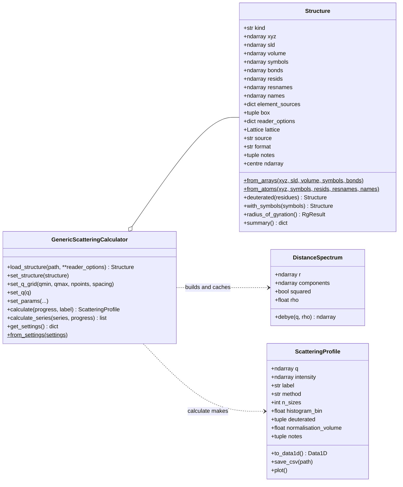
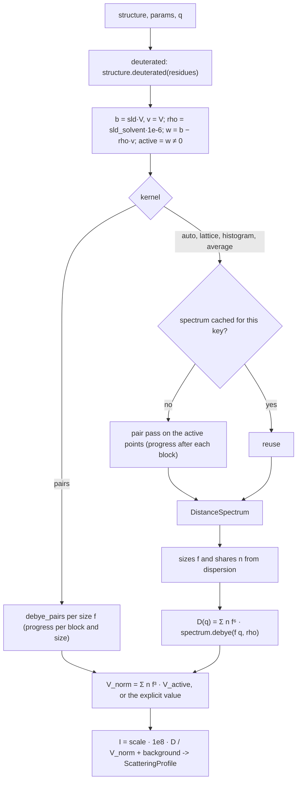

# Combined design: one `gsc` for SasView structures and MD aggregates

Status: 2026-10-29, proposal for review; revised 2026-10-30 after the first review
(reader options on `Structure`, `calculate_series`, bin width with sizes, non-empty bins,
element guesses, coords2sans compatibility, PR 4 split). It follows `GSC_INTEGRATION_PLAN.md`
(coords2sans, 2026-10-29), takes its decision as given (coords2sans moves into gsc,
multiprocessing and project glue go to shapespyer) and turns it into one package design.
Section 14 answers the plan's open questions.

Read for this design: gsc 0.1.0 (`src/gsc` in this repository), coords2sans
(`github.com/seventil/coords2sans`, `main` today), the integration plan.

## 1. Summary

- **One library, `gsc`.** gsc's data model (`Structure`), calculator, result
  (`ScatteringProfile`), provenance (`get_settings` / `from_settings`), progress and cancel
  stay. coords2sans's features are added as reader options, `set_params` keys and
  kernels. coords2sans is archived once the validation of plan section 7 passes.
- **One equation, four kernels.** Every kernel computes the same Debye sum. Three of them
  (lattice, histogram, average) first build a *distance spectrum*, a short list of
  (r, weight) pairs; D(q) is then a sinc sum over it. The spectrum is kept between
  calls, so a change of solvent SLD or a spread of sizes costs only sinc sums. The
  fourth kernel (`pairs`) is the exact reference, unchanged.
- **Residue data on `Structure`.** Optional fields `resids`, `resnames`, `names`,
  `element_sources` and `box`, and the `reader_options` it was read with; the structure
  stays a frozen snapshot. Derived structures (deuterated, corrected elements) are new
  `Structure` objects.
- **Dependencies:** numpy and periodictable. plotly (`gsc[plot]`) and sasdata
  (`gsc[sasdata]`) become optional extras, as the plan asks.
- **What shapespyer gets:** `.gro` files, residue selection, unwrapping, elements from
  topology masses, per-residue deuteration, fast exact and ⟨A⟩² kernels, size
  polydispersity, a contrast series in one call (`calculate_series`), and a JSON
  settings record that rebuilds the calculation in another process. What it keeps for
  itself: processes, topology readers, project storage, the SLD unit at its boundary,
  kernel policy.

## 2. The two implementations today

| | gsc 0.1.0 | coords2sans | Kept in the merge |
|---|---|---|---|
| Structure | frozen dataclass; `kind` atoms / pixels / cells; `xyz`, `sld`, `volume` stored per point; `symbols`, `bonds`, `lattice`, `cell_diameter`; source path, SHA-256, notes | mutable class, atoms only; `resids`, `resnames`, `names`, `positions`; `elements` editable; `sld(deuterated)` and `volume` computed from elements on each call; `element_sources`; `centre` | gsc's, with coords2sans's residue fields, `element_sources` and `centre` added |
| Readers | PDB (SasView policies), SLD, VTK; `load()` by extension; waters HOH / DOD / WAT dropped; HETATM opt-in; 3-letter residue names | `.gro` and PDB; `residues=` selection; periodic unwrapping (`.gro`); elements from `masses=`, `elements=`, PDB column, name guess; 4-letter residue names | all of both, one pipeline for the residue steps |
| Kernels | `debye_pairs` (every pair, every q; blocks; progress), `debye_lattice` (FFT); `_sinc_sum` with reused buffers | `_pair_histogram` (pairs counted by distance, 0.01 Å bins, blocks of 1e6 pairs), ⟨A⟩² (`average_amplitude`); `_sinc_sum` allocating per q | all four kernels on gsc's `_sinc_sum`, behind one spectrum interface |
| Parameters | `scale`, `background`, `sld_solvent` (10⁻⁶ Å⁻²), `normalisation_volume`; q grid log / linear or explicit | `solvent_sld` (Å⁻²), `deuterated`, q range, `scale`, `background`, `polydispersity`, `size_points`, `average_amplitude` | gsc's names and units; new keys `deuterated`, `kernel`, `histogram_bin`, `size_pd`, `size_pd_n`, `size_pd_nsigma` |
| Normalisation | volume of the points with non-zero contrast ("active"), or explicit | volume of all atoms; mean over sizes | gsc's, extended with the mean over sizes |
| Result | `ScatteringProfile`: q, I, V_norm, kernel, notes, elapsed, params, structure summary; `to_data1d`, `save_csv`, `plot`, `describe` | `Curve`: q, I, label; `save`, `load`, `plot` (matplotlib) | `ScatteringProfile`, plus `label` |
| Provenance | `get_settings()` (path, hash, grid, params, versions), `from_settings()` | none in the library; `SansTask` carries path and settings | gsc's, extended to every new option; it is the task format |
| Progress, cancel | `calculate(progress=)`, `CalculationInterrupted` | none | gsc's, in every blocked kernel |
| Warnings | solvent unit, near-match, cell size, atomic volumes, large pair loop | element guesses | both, as reader notes and profile notes |
| Dependencies | numpy, plotly, periodictable, sasdata (all required) | numpy, periodictable; matplotlib optional | numpy, periodictable; plotly and sasdata optional |
| Tests | 3 files, SasView reference data, brute-force kernel checks | 4 files, synthetic `.gro` / PDB, SasView-equivalence checks | both suites, ported |

Why gsc is the base and not the other way round: it already covers three structure
kinds, the lattice kernel, provenance, progress and the fit hand-over. coords2sans's
value is in features, each of which maps to a reader option, a parameter or a kernel.

Note on the plan's section 1: the three sans_fitter imports it lists are already cut in
this repository (`validate_q_grid`, `_package_version` and the plotting helpers are
local). The split is done; what remains of it is the dependency clean-up in PR 0.

## 3. Design rules

1. **gsc's public API is the base.** Everything new is a keyword argument, a `set_params`
   key, a `Structure` method or an optional field. Existing calls keep working; the
   behaviour changes are listed in section 11.
2. **`Structure` is a frozen snapshot.** Anything that would edit it returns a new
   `Structure`: `deuterated()`, `with_symbols()`. Readers do all preparation (select,
   unwrap, assign elements) before the snapshot exists.
3. **Units do not move.** Positions in Å, structure SLD in Å⁻² (as the files store it),
   `sld_solvent` in 10⁻⁶ Å⁻² (as every sasmodels parameter). shapespyer converts at its
   boundary (plan S6).
4. **A kernel computes D(q) and nothing else.** Contrast, sizes, normalisation and
   background are the calculator's. The kernel is a parameter and is recorded in the
   profile.
5. **`get_settings()` is complete.** Anything that changes a curve is in it, and
   `from_settings()` replays it. The reader options travel with the `Structure`, so a
   structure read with `gsc.load()` and installed with `set_structure()` records them
   too; a structure that no file and options can rebuild records itself as in-memory.
   That makes it the multiprocessing contract: a task is a settings dict and a series
   (section 8.5).
6. **The library knows no topology files, processes, projects or GUIs.** It takes
   masses and element lists as plain mappings and returns plain objects.

## 4. Package layout

```
src/gsc/
  __init__.py          exports, as today plus read_gro, DistanceSpectrum
  _console.py          logger and glyphs (unchanged)
  elements.py          NEW  periodictable facade: SLD, volume and mass per element,
                            mass -> element, the two atom-name guesses
  model.py             Structure (+ residue fields, box, reader_options, centre, deuterated,
                            with_symbols, from_atoms), Lattice, RgResult (as today)
  molecules.py         NEW  residue-level steps shared by the readers and Structure:
                            residue runs, selection, unwrapping, element assignment,
                            deuteration
  readers/
    __init__.py        load(), re-exports (read_*, and cell_geometry, which the tests import)
    _common.py         hashing, source resolution
    pdb.py             read_pdb (today's code; residue data, residues=, unwrap=)
    gro.py             NEW  read_gro
    sld.py             read_sld (unchanged)
    vtk.py             read_vtk (unchanged)
  debye.py             _sinc_sum, debye_pairs (as today);
                       NEW  DistanceSpectrum, spectrum_lattice (replaces debye_lattice),
                            spectrum_histogram, spectrum_radial
  dispersion.py        NEW  size factors and shares (Gaussian, sasmodels rule)
  calculator.py        GenericScatteringCalculator (+ calculate_series), ScatteringProfile
                            (extended)
  plotting.py          plotly views (optional extra; lazy import)
```

`readers.py` is 500 lines today; `.gro` and the residue pipeline would take it past 900,
so it becomes a package. `molecules.py` and `elements.py` exist because `Structure`
methods (deuteration, element correction) need the same code as the readers.

## 5. Data model

### 5.1 `Structure`

| Field | Today | Change |
|---|---|---|
| `kind`, `xyz`, `sld`, `volume` | required | unchanged; `sld` and `volume` stay stored per point, because pixels and cells have no elements |
| `symbols`, `bonds` | atoms only | unchanged. `symbols` is the name of coords2sans's `elements` |
| `cell_diameter`, `lattice` | cells / pixels only | unchanged |
| `source`, `source_sha256`, `format`, `notes` | | unchanged; `format` gains `'gro'`; `from_atoms` uses `'arrays'`, as `from_arrays` does |
| `resids`, `resnames`, `names` | – | NEW, atoms only, default None; int, str and str arrays, one per atom. `read_pdb` and `read_gro` fill them; `from_arrays` leaves them None unless given |
| `element_sources` | – | NEW, `dict[str, str]` by residue name: `'masses'`, `'elements'`, `'pdb'`, `'names'` or `'given'` (`from_atoms`); empty for non-atom kinds and for atoms without residue names |
| `box` | – | NEW, a tuple of three floats or None, Å: the rectangular periodic box the file declared (`.gro` last line; PDB `CRYST1` unless it is the 1 Å placeholder), whether or not unwrapping used it. None for a triclinic box read with `unwrap=False`, with a note |
| `reader_options` | – | NEW, a dict or None: the options the reader was called with (6.1), every key filled, so the file plus this dict rebuilds the structure. None for structures no reader made: `from_arrays`, `from_atoms` and every derived copy (`deuterated`, `with_symbols`). See 8.4 for how settings use it |

New members:

| Member | What it does |
|---|---|
| `Structure.from_atoms(xyz, symbols, *, resids=None, resnames=None, names=None, bonds=None)` | NEW class method: atoms whose `sld` and `volume` come from the elements (`elements.constants`). This is how shapespyer hands over atoms it read itself, without a file. `source='in-memory'`, `format='arrays'`, `element_sources` `'given'` per residue name, `reader_options=None` |
| `structure.deuterated(residues)` | NEW: a copy in which the hydrogens of these residues have the SLD of D; volumes unchanged (D and H have the same natural volume). Unknown residue name, a residue name without hydrogens, or a structure without residue data: `StructureError`. The copy keeps `source` and `source_sha256`; `reader_options=None` |
| `structure.with_symbols(symbols)` | NEW: a copy with corrected elements, `sld` and `volume` recomputed, `element_sources` set to `'elements'` for every residue touched. Replaces coords2sans's editable `elements`. The copy keeps `source` and `source_sha256`; `reader_options=None` |
| `structure.centre` | NEW property: the middle of the bounding box, as SasView's `transform_center`; the ⟨A⟩² kernel's origin |
| `structure.summary()`, `describe()` | extended: residue count, residue names with atom counts, `element_sources`, box |



### 5.2 `elements.py`

One place for what today is spread over `readers._element_constants`,
`model.Structure.masses` and coords2sans's module constants:

- `constants(symbol) -> (sld, volume, mass)`: SasView's formulas (`nsf.neutron_sld`,
  `mass / density / AVOGADRO`), SasView's Avogadro number. Unknown or non-finite:
  `StructureError` naming the symbol, as gsc does today.
- `MASS_TABLE`: H to U and D, with `MASS_TOLERANCE = 0.01` u (coords2sans's rule and its
  reasoning: force fields round by less than 0.005 u, a united-atom CH₂ at 14.027 u must
  not pass as N).
- `element_from_mass(mass)`, `guess_pdb(line)` (SasView's column rule, today's
  `_element_from_name`) and `guess_stem(name, single_atom)` (coords2sans's rule,
  narrowed: leading digits dropped; a two-letter name that is an element is that element
  only when its residue has one atom, otherwise the first letter; see 6.3).

## 6. Readers

### 6.1 `load()` and the reader options

```python
load(path, *, include_hetatm=False, residues=None, masses=None, elements=None, unwrap='auto')
```

`load_structure` takes the same keywords. The reader stores them, every key filled, as
`structure.reader_options` (5.1), so `from_settings` replays them however the structure
was installed. SLD and VTK files ignore the residue options with a note.

| Option | Formats | Meaning |
|---|---|---|
| `include_hetatm` | PDB | as today |
| `residues` | PDB, GRO | residue names of the aggregate. Only their atoms are read. **When given, it is the whole selection:** HETATM and water rules do not apply, the user has named what they want. No atom found: `StructureError` |
| `masses` | PDB, GRO | by residue name, the atom masses in u in topology order |
| `elements` | PDB, GRO | by residue name, the element symbols in order |
| `unwrap` | GRO, PDB | `'auto'`: `.gro` yes (the box is on the last line), PDB no (many programs write a placeholder `CRYST1`). `True`: PDB uses `CRYST1`; a missing or 1 Å box is an error. `False`: never. Triclinic boxes: `StructureError` unless `unwrap=False` |

### 6.2 Per format

| Format | Today | Change |
|---|---|---|
| PDB | first MODEL; one altloc; waters dropped; HETATM opt-in; element column else SasView's name guess; CONECT bonds | residue name from columns 18–21 (`strip()` gives the same result for standard files); `resids`, `resnames`, `names` filled; the water list gains the MD names `SOL`, `TIP3`, `TIP4`, `SPC`, `SPCE`, `OPC` (four columns, so not `TIP3P` or `TIP4P`) (noted when something is dropped); residue pipeline (6.3) |
| GRO | – | NEW `read_gro`: fixed columns (names may touch numbers), position width from the decimal points of the first atom (`gmx -ndec` files), nm to Å, box from the last line; velocities ignored. No water rule: a `.gro` of a solvated system needs `residues=`, and the reader says so in a note when it reads more than one residue name without a selection |
| SLD, VTK | | unchanged |

### 6.3 The residue pipeline (`molecules.py`)

Shared by `read_pdb` and `read_gro`, in this order, each step one function:

1. **Select** the atoms of `residues` (all when None).
2. **Unwrap** (when the box is known and `unwrap` allows): a molecule is a run of atoms
   with one residue number and name; each molecule is made whole around its first atom, the
   aggregate centre is the circular mean of the molecule centres (unchanged by a split),
   each molecule moves by whole box lengths next to it. coords2sans's
   `_fix_periodic_wrapping`, verbatim. A note records the shift count. Works for one
   aggregate smaller than half the box; several aggregates in one file need a selection
   by residue numbers, which is later work.
3. **Assign elements**, per residue name, from the first source that has it:
   `masses`, then `elements`, then the PDB element column (when filled for every atom of
   the residue), then a guess from the atom names. Masses and element lists are matched
   by the atom's position inside its residue, so structure and topology names may
   differ. A residue whose atom count differs from its list, a mass farther than 0.01 u
   from every element, or a guess that is no element: `StructureError` with the residue
   name and the hint to pass `masses=` or `elements=`.
4. **Record**: `element_sources` per residue; a note "Elements of X, Y guessed from atom
   names" that also lists every two-letter assignment with its residue (for example
   "BR -> Br in BR; CL -> Cl in CL"), since those are the guesses most likely to be
   wrong. gsc turns reader notes into warnings when the structure is installed, which is
   coords2sans's warning.

The guess differs by format on purpose: PDB keeps SasView's column rule (alpha carbon
` CA ` is carbon, as in every protein file; this is the current behaviour), `.gro` uses
the stem rule, because there is no column convention. The stem rule takes a two-letter
element only for a residue of one atom: in a protein `.gro`, `CA`, `CD`, `CE`, `NE`, `HE`
and `HG` would otherwise become Ca, Cd, Ce, Ne, He and Hg, while ions (`NA`, `CL`, `BR`,
`CA`, `MG`, `ZN`) are one-atom residues. The two-letter list in the note covers both
formats: a left-aligned `HG1` in a PDB file is mercury under SasView's rule.

## 7. Kernels (`debye.py`)

### 7.1 One sum, one spectrum

All kernels compute

```text
D(q) = Σ_j Σ_k w_j w_k sinc(q r_jk),      w_j = b_j − ρ v_j,  b_j = sld_j V_j,  v_j = V_j
```

Three of them do it in two steps: a pair pass that depends on geometry and composition
but not on the solvent, and a sinc sum that depends on q and ρ. The pair pass returns a
`DistanceSpectrum`:

```python
@dataclass(frozen=True)
class DistanceSpectrum:
    r: np.ndarray            # distances, Å; only those with a non-zero component
    components: np.ndarray   # (3, n): bb, bv, vv  -- or (2, n): b, v when squared
    squared: bool            # False: D = Σ W sinc; True: D = (Σ A sinc)²

    def debye(self, q, rho) -> np.ndarray:
        # pair form:  W(r) = bb − 2ρ bv + ρ² vv, then _sinc_sum(q, r, W)
        # squared:    A(q) = Σ (b − ρ v) sinc(q r), then A²
```

The proposal also had a `(1, n)` form at a fixed ρ, as a fallback in case the three
components made the pair pass too slow; PR 4a measured them within bounds (7.5), so it
was not built.

Every builder keeps only the distances where some component is non-zero: the histogram
drops its empty bins, the lattice spectrum its empty lags. The sinc phase then costs
(distances kept) × q, and the distances kept are never more than the pairs, so a
spectrum kernel is never slower than `pairs` in that phase. Without this, C60 at
q_max = 0.3 would have about 2,100 bins against 1,770 pairs; with it, a few dozen
distinct distances.

Keeping b and v apart (three histograms, plan section 10) makes every further solvent
SLD cost only the sinc sums: a contrast-variation series over one frame is one pair
pass. For `squared` the split is exact (two radial sums). For the pair form it is a
subtraction of like terms, which loses one or two digits at ordinary contrasts
(carbon in D₂O: b² is about 55 w²) and only matters for points that nearly match the
solvent, which the near-match warning already flags. Points that match exactly are left
out before the pass, as today, so the "every point matches" and `V_norm` logic is
unchanged.

### 7.2 The four kernels

| `kernel=` | Builds | Exact? | Time grows with | Memory | Progress | Sizes (G8) | When |
|---|---|---|---|---|---|---|---|
| `lattice` | `spectrum_lattice(grid_b, grid_v, step)`: 2 forward FFTs, 3 inverse (bb, bv, vv), lags grouped by exact integer key | yes | grid cells · log | padded grid, as today (`LATTICE_MAX_CELLS`) | no (sub-second) | one sinc sum per size | pixels on a lattice (`.sld`): today's path |
| `histogram` | `spectrum_histogram(xyz, b, v, bin_width, block, progress)`: coords2sans's pass (squared distances from a matrix product per block of about 10⁶ pairs, `rint` to the bin, three `bincount`s) | to about 1e-4 (rounding at most bin/2, see 7.3) | atoms² once, then bins × q | a block plus the bins | after each block | one sinc sum per size | atoms and cells of any shape, the default |
| `average` | `spectrum_radial(xyz, b, v, centre)`: each atom's distance from `structure.centre`, `squared=True` | only for spherically symmetric structures | atoms × q | atoms | no | one sinc sum per size | round aggregates above about 10⁵ atoms; reproducing SasView `is_avg=True` and polyJD |
| `pairs` | none: `debye_pairs(q, xyz, w)` as today | yes, to the last digit | atoms² × q | a block | after each block | one full pass per size | reference in tests; small structures where the last digits matter |

`ScatteringProfile.method` takes the kernel name (`'lattice'`, `'pairs'`, `'histogram'`,
`'average'`, `'none'`). The `average` kernel also adds the note "⟨A⟩² kernel: exact only
for spherically symmetric structures; the result depends on the centre" to the profile.

### 7.3 Histogram bin width

coords2sans fixes `BIN_WIDTH = 0.01` Å, validated to 1e-4 up to q = 0.2 Å⁻¹. gsc's grids
go to 0.3 by default and to 3 Å⁻¹ in its tests, where 0.01 Å would give phase errors of
1.5 %. The spectrum is also evaluated at f · q for every size factor f (8.2), so the
rounding error grows with the largest factor, as coords2sans's own docstring notes. So
the bin follows the grid and the sizes:

```text
histogram_bin = 'auto'  ->  bin = min(0.01 Å, 1e-3 / (q_max · f_max))
f_max = 1 + size_pd_nsigma · size_pd   (1 for one size), the largest factor (section 9)
```

The largest rounding error f_max · q_max · bin / 2 then stays below 5e-4 rad at any grid
and spread, inside the validated regime. At q_max = 0.3 and one size the bin is
0.0033 Å; with `size_pd = 0.1` (f_max = 1.3) it is 0.0026 Å. A 100 Å structure has at
most 30,000 bins at one size, a 500 Å vesicle at q_max = 3 Å⁻¹ at most 1.5 million; only
the occupied ones are kept (7.1). The bin used is recorded in
`ScatteringProfile.histogram_bin`. A float sets it explicitly. The cell-size warning
(`CELL_SIZE_LIMIT`) uses f_max · q_max too, for the same reason.

### 7.4 Choosing the kernel: `kernel='auto'`

```text
lattice     if structure.lattice is not None and the padded grid fits LATTICE_MAX_CELLS
histogram   otherwise
```

That is: pixels as today, atoms and cells by the histogram. `pairs` and `average` are
chosen by name. The alternative, `pairs` below some atom count and `histogram` above it,
was rejected: one default for all sizes is easier to explain, the 1e-4 difference is
below anyone's care, and `pairs` remains one keyword away. A forced kernel that cannot
run (`lattice` on atoms) is a `ValueError` at `calculate()`.

Run-time warnings move with the kernels: `pairs` keeps `LARGE_PAIR_LOOP = 20_000`,
`histogram` gets `LARGE_HISTOGRAM = 100_000` (about 6 min at 130,000 atoms, per the plan).

### 7.5 The spectrum cache

The calculator keeps the last `DistanceSpectrum` with its key:

```text
(structure, deuterated, resolved kernel, resolved bin, active mask)
```

The structure is held by reference, not by `id()`, which can be reused once an object is
freed. `set_params(sld_solvent=…)`, `scale`, `background` and `normalisation_volume` do
not change the key, and the size parameters change it only through the resolved bin;
`load_structure`, `set_structure`, `deuterated`, `kernel`, a bin change (also through
`set_q_grid`, `set_q` or the size parameters, when `'auto'`) and a change of the active
set do. A cached spectrum with a finer bin than the one needed is reused, so a sweep
towards smaller spreads or a lower q_max does not repeat the pair pass. So the shapespyer loop "for each contrast: `set_params`; `calculate()`"
pays the pair pass once per frame and deuteration state. The cache holds one entry; it
is an optimisation, not state the user sees, and `get_settings()` ignores it.

Cost, measured in PR 4a: three `bincount`s instead of one take 1.69 s against 1.07 s for
11,000 atoms, 1.6× (the plan's prototype was about 3×, 7 s against 2.3 s). That is within
the 2× threshold set here, so the three components and the cache went in, and the
(1, n) fallback with ρ in the cache key was not needed. The lattice spectrum takes 2
forward and 3 inverse FFTs; it finds the lags some pair has from C_vv, which is at least
the smallest volume squared there, so it needs no FFT of the occupation.

## 8. Calculator and profile

### 8.1 `set_params`

| Key | Default | Meaning | From |
|---|---|---|---|
| `scale`, `background`, `sld_solvent`, `normalisation_volume` | as today | unchanged | gsc |
| `deuterated` | `()` | residue names whose hydrogens count as D. Checked against `structure.resnames` at `calculate()` (a structure without residue data cannot be deuterated). Applied through `structure.deuterated()` | coords2sans `deuterated` |
| `kernel` | `'auto'` | section 7.4 | coords2sans `average_amplitude`, new |
| `histogram_bin` | `'auto'` | section 7.3, Å | coords2sans `BIN_WIDTH` |
| `size_pd` | `0.0` | relative standard deviation of the size factor; 0 is one size | coords2sans `polydispersity` |
| `size_pd_n` | `35` | number of sizes | coords2sans `size_points` |
| `size_pd_nsigma` | `3.0` | half-range of the sizes in σ | coords2sans `SIZE_RANGE` |

The names follow sasmodels (`radius_pd`, `radius_pd_n`, `radius_pd_nsigma`), with `size`
for the length factor of a whole structure. `size_pd_type` is reserved for later
distributions and is not a parameter yet.

### 8.2 `calculate(*, progress=None, label=None)`



A size f stretches every distance by f and every amplitude by f³, so it contributes
f⁶ · D(f q); the spectrum is evaluated at f q, which is why sizes cost only one sinc
sum each with spectrum kernels. With `pairs` the full sum runs per size, and the calculator warns that
`histogram` would do the same in a fraction of the time.

Normalisation with a spread follows sasmodels and coords2sans: Σ n·f⁶·D(fq) over
Σ n·f³·V, the shares n adding to 1, so `scale` stays a volume fraction. V is gsc's active
volume, as today; coords2sans's "volume of all atoms" equals it whenever no atom matches
the solvent, which is the MD case.

### 8.3 `ScatteringProfile`

New fields, all filled by the calculator: `label` (default: the file's basename),
`n_sizes`, `histogram_bin` (None for other kernels), `deuterated`. `params` and
`structure_summary` carry the new keys. `method` takes the kernel names of 7.2.
`to_data1d` and `plot` import sasdata and plotly lazily and raise an `ImportError` that
names the extra. `save_csv` stays (two columns, comma, commented header); the validation
of section 12 checks that SasView's ASCII reader opens it, as coords2sans checked its own
format.

### 8.4 The settings record

```json
{
  "source": "/data/CTA178-eq5.gro",
  "source_sha256": "…",
  "reader_options": {
    "include_hetatm": false,
    "residues": ["CTA"],
    "masses": {"CTA": [14.007, 12.011, 1.008, "…"]},
    "elements": null,
    "unwrap": "auto"
  },
  "q_grid": {"qmin": 0.002, "qmax": 0.2, "npoints": 256, "spacing": "log"},
  "q": ["…"],
  "params": {
    "scale": 0.01, "background": 0.05, "sld_solvent": 6.36, "normalisation_volume": "auto",
    "deuterated": ["CTA"], "kernel": "auto", "histogram_bin": "auto",
    "size_pd": 0.1, "size_pd_n": 35, "size_pd_nsigma": 3.0
  },
  "versions": {"gsc": "0.2.0", "numpy": "…", "periodictable": "…"}
}
```

`from_settings` fills missing keys with defaults, so 0.1.0 records still replay, with
one exception: a record without `kernel` replays with the kernel 0.1.0 used, `'auto'`
for pixels on a lattice and `'pairs'` otherwise, so it gives the curve it recorded. The
`masses` mapping is JSON as it is; a few hundred floats per residue type.

`reader_options` is `structure.reader_options`, whether the structure came through
`load_structure` or `set_structure`. A structure without them (`from_arrays`,
`from_atoms`, a `deuterated` or `with_symbols` copy) is recorded as `source: 'in-memory'`;
a derived copy also gets `derived_from` with the file path, for information only.
`from_settings` refuses in-memory records, as today. This closes a hole in 0.1.0, where
`set_structure(gsc.load(path, include_hetatm=True))` recorded no options, and the record
replayed with the defaults while the file hash still matched.

### 8.5 `calculate_series(series, *, progress=None)`

```python
profiles = calc.calculate_series([
    {'label': 'h-CTA in D2O', 'params': {'sld_solvent': 6.36}},
    {'label': 'h-CTA in H2O', 'params': {'sld_solvent': -0.56}},
    {'label': 'd-CTA in H2O', 'params': {'sld_solvent': -0.56, 'deuterated': ['CTA']}},
])
```

Each entry is a `label` and a dict of `set_params` keys that override the calculator's
parameters for that entry only; keys not given keep the current values.

- Every entry is checked as `set_params` checks it before anything runs; a bad key or
  value is a `ValueError` naming the entry.
- Entries run grouped by the cache key of 7.5, so the pair pass runs once per
  deuteration state and kernel, not once per entry. The profiles come back in the order
  given, each with its own `label` and merged `params`.
- `progress` receives the fraction of the whole series; returning True raises
  `CalculationInterrupted` and leaves parameters and `profile` as before the call.
- Afterwards the parameters are those before the call, and `profile` is that of the last
  entry given.
- A series is plain JSON (labels, numbers, residue names), so a shapespyer task is
  `get_settings()` plus a series, and the child runs
  `from_settings(settings).calculate_series(series)`.

The q grid is not a series key: one series, one grid, which is what comparing and
averaging curves needs.

## 9. Size polydispersity (`dispersion.py`)

```python
def gaussian_sizes(pd: float, n: int, nsigma: float) -> tuple[np.ndarray, np.ndarray]:
    """Size factors f and their shares n, Σ n = 1. pd = 0 or n = 1: ([1.0], [1.0])."""
```

coords2sans's `_sizes` as a function: f evenly from 1 − nsigma·σ to 1 + nsigma·σ, factors
at or below 0 dropped, shares the Gaussian's height there, normalised. This is sasmodels'
`GaussianDispersion`, which the plan's validation checks against the `sphere` model
(agreement 4e-6 today). Checks (`pd >= 0`, `n >= 1`) run in `set_params`, where gsc checks
everything else. Other shapes (lognormal, Schulz) would be new functions behind
`size_pd_type`; the interface is the same (factors, shares).

## 10. What shapespyer builds on top

| Plan | shapespyer does | gsc provides |
|---|---|---|
| S1 task | a dataclass of `settings: dict` (from `get_settings()`) and `series: list` (8.5); `run()` is `from_settings(settings).calculate_series(series)`. One task per frame with the frame's contrasts and deuterations as the series: the child loads once, and the pair pass runs once per deuteration state | `get_settings`, `from_settings`, `calculate_series`, the cache |
| S2 progress, cancel | `calculate_series(series, progress=job.report)`; returning True raises `CalculationInterrupted` | unchanged |
| S3 masses | `masses={species: Species.masses}` into `load_structure` | `masses=` |
| S4 residues, deuteration | `residues=[...]` from the project's species; `deuterated` per series entry | `residues=`, `deuterated` |
| S5 storage | the profile's arrays and `get_settings()` as provenance; `notes` for the warnings | `ScatteringProfile`, `get_settings` |
| S6 policy | `kernel='average'` for round aggregates above about 10⁵ atoms, else `'auto'`; `sld_solvent = value_in_A2 * 1e6` | `kernel`, the unit convention |
| atoms already in memory | `Structure.from_atoms(xyz, symbols, resids=, resnames=, names=)` from its own readers, then `set_structure`; provenance stays with shapespyer (`from_settings` cannot replay an in-memory structure, as today) | `from_atoms` |

Children should call `gsc.set_verbosity('quiet')`; the logger is per process.

## 11. Compatibility

### 11.1 For gsc 0.1.0 users

| Change | Effect | Keep the old behaviour |
|---|---|---|
| default kernel for atoms and cells: `histogram` instead of `pairs` | I(q) moves by up to about 1e-4 relative; `profile.method` reads `'histogram'`. A 0.1.0 settings record has no `kernel` and replays with `'pairs'` (`'auto'` for pixels on a lattice), as it was computed | `set_params(kernel='pairs')` |
| sasdata and plotly optional | `to_data1d`, `plot_points`, `plot_profile` raise `ImportError` without the extra | `pip install gsc[plot,sasdata]` |
| PDB residue name from 4 columns; MD water names dropped | none for standard PDB files; `SOL` / `TIP3` water in MD-written PDB files is dropped with a note | `residues=` names exactly what to read |
| PDB elements chosen per residue name | the element column is used only for a residue name whose atoms all fill it; otherwise every atom of that name is guessed from its atom name, and a PDB with guessed elements warns | `elements=` for that residue name |
| `.gro` unwrapped by default | molecules that cross a box face move by whole box lengths, with a note counting the atoms moved; a zero box means no unwrapping | `unwrap=False` |
| new `Structure` fields | default None; `from_arrays` unchanged | – |
| `ScatteringProfile` fields | new fields; only the calculator constructs it | – |
| `get_settings()` keys | more keys; old records replay | – |
| `set_structure` keeps the structure's reader options | a record made after `set_structure(gsc.load(path, include_hetatm=True))` now holds the option; before, it held none and replayed with the defaults | – |
| derived structures (`deuterated`, `with_symbols`) | recorded as in-memory, with `derived_from` | – |

Everything in gsc's test suite that asserts 1e-12 agreement against `debye_pairs` on
atoms or cells passes `kernel='pairs'` or compares against the histogram at 1e-4.

### 11.2 For coords2sans users

| coords2sans | gsc |
|---|---|
| `Structure.read(path, residues, masses, elements)` | `gsc.load(path, residues=, masses=, elements=)` or `calc.load_structure(...)` |
| `Structure(resids, resnames, names, positions, elements)` | `Structure.from_atoms(xyz, symbols, resids=, resnames=, names=)` |
| `structure.positions` | `structure.xyz` |
| `structure.elements`, editable | `structure.symbols`; `structure.with_symbols(new)` |
| `structure.element_sources`, `structure.centre`, `structure.volume` | the same |
| `structure.sld(deuterated=[...])` | `structure.deuterated([...]).sld`, or `set_params(deuterated=[...])` |
| `SansCalculator(solvent_sld=6.36e-6)` | `set_params(sld_solvent=6.36)` (10⁻⁶ Å⁻²) |
| `q_min`, `q_max`, `q_points`, `q_log` | `set_q_grid(qmin, qmax, npoints, spacing='log' or 'linear')`; default grid is SasView's (3e-4 to 0.3, 30 points), not 0.002 to 0.2, 256 |
| `scale`, `background` | the same |
| `polydispersity`, `size_points`, `SIZE_RANGE` | `size_pd`, `size_pd_n`, `size_pd_nsigma` |
| `average_amplitude=True` | `kernel='average'` |
| default (histogram), `BIN_WIDTH` | `kernel='auto'`, `histogram_bin` (`'auto'`: at most 0.01 Å, smaller at high q and with a size spread) |
| PDB without an element column: atom names guessed by the stem rule (` CA ` is calcium) | SasView's column rule (` CA ` is carbon, `CA` starting in column 13 calcium) |
| `.gro`: a two-letter name that is an element is that element | only in a one-atom residue (ions); otherwise the first letter, so `CA` in a protein is carbon. Every two-letter guess is listed in the note |
| `calculate(structure, label)` -> `Curve` | `set_structure(structure)`; `calculate(label=)` -> `ScatteringProfile` |
| `Curve.save` | `profile.save_csv`: the same two comma-separated columns, header lines starting with `#` |
| `Curve.load` | none: gsc has no reader for its own CSV. `np.loadtxt(path, delimiter=',')` reads the two columns; shapespyer keeps profiles in its project (S5) |
| `Curve.plot(ax)` (matplotlib) | no matplotlib in gsc: `ax.plot(profile.q, profile.intensity)`; `profile.plot()` draws with plotly (`gsc[plot]`); `profile.to_data1d()` for sasdata |
| `SansTask` | `get_settings()`, `from_settings()` and `calculate_series()`; the task class lives in shapespyer |
| normalisation by all atoms | by atoms with non-zero contrast; equal unless an atom matches the solvent |
| `.gro` always unwrapped, PDB never | the same under `unwrap='auto'`; PDB on request |

## 12. Tests and validation

Ported from coords2sans, one test module per gsc module:

- `test_readers`: `.gro` fixed columns and `-ndec` widths, triclinic refusal, PDB
  4-letter names and HETATM under `residues=`, placeholder `CRYST1`, `box` stored with
  `unwrap=False`, selection, "no such residue", unwrapping (split aggregate rejoined,
  whole one untouched), `reader_options` on the structure with every key filled.
- `test_molecules` / `test_elements`: masses by position, D by mass, source order and
  `element_sources`, the two name guesses (protein `CA` in `.gro` is carbon, a one-atom
  `CA` residue calcium; the note lists every two-letter guess), refusals (HMR, united
  atom, count mismatch, no element), `with_symbols`, `deuterated` (only the named
  residues' H, volumes kept), both copies with `reader_options=None`.
- `test_debye`: histogram against `debye_pairs` at 1e-4 (atoms on a line: the closed
  form, 3 and 1500 atoms so blocks are crossed), bin width follows q_max and f_max, only
  non-empty bins kept (C60: fewer distances than pairs), ⟨A⟩² against
  the analytic sphere and the bounding-box centre, three-component spectrum against the
  single-w sum, lattice spectrum against `debye_pairs` (only the lags of pairs kept).
- `test_dispersion`: one size, Gaussian over ±3σ, dropped sizes, refusals.
- `test_calculator`: sizes scale distances and volumes (closed form, both kernel
  families), background added once, `deuterated` equals a structure written with D,
  forward scattering at q = 0, cache reuse across `sld_solvent` (same result, no pair
  pass: assert through the progress callback), a finer cached bin reused,
  `calculate_series` (equal to separate `calculate()` calls, one pair pass per
  deuteration state, parameters restored, an interrupted series changes nothing),
  `set_structure(gsc.load(..., residues=...))` then `get_settings()` replays the
  selection, a derived structure records in-memory, `from_settings` in a spawned child
  gives the same profiles (coords2sans's `SansTask` test).

Validation (plan section 7), by hand after the G8 PR: `examples/compare.ipynb` and
`usage.ipynb` rewritten for gsc on the CTAB micelle: histogram against SasView's plain
pair sum (1e-4), `average` against `GenSAS is_avg=True` (1e-13), sizes against sasmodels'
`sphere` (4e-6), the ⟨A⟩² / exact ratio table.

## 13. Delivery order

Each PR carries its tests and a README section. The order keeps every PR independent of
the ones after it.

| PR | Content | Plan items |
|---|---|---|
| 0 | optional extras and lazy imports; `elements.py` extracted; `readers/` package (re-exporting `cell_geometry`); README no longer says "from the SANS-fitter repository root". No behaviour change | section 1 |
| 1 | residue fields, `box` and `reader_options` on `Structure`, the latter used by `set_structure` and `get_settings`; `read_gro`; `residues=`; 4-column residue names; MD water names | G1, G2 |
| 2 | `molecules.py`: unwrapping, `masses=`, `elements=`, `element_sources`; `with_symbols`; `from_atoms` | G3, G4 |
| 3 | `deuterated()` and `set_params(deuterated=)` | G5 |
| 4a | `DistanceSpectrum` with non-empty bins only; histogram, average and lattice spectra in the (1, n) form at the current solvent; `kernel`, `histogram_bin` (the 7.3 rule, f_max = 1 until PR 5); new warnings; `method` names; benchmark of the three-component pass against the single one | G6, G7 |
| 4b | the b/v split (three components, two for `squared`) and the spectrum cache if the 4a benchmark stays within 2×; otherwise the cache on the (1, n) form with ρ in the key | plan section 10 |
| | *Done as one PR: the benchmark gave 1.6×, so 4b's split and cache went in directly and the (1, n) form was never built* | |
| 5 | `dispersion.py`; `size_pd*`; normalisation with sizes; f_max in the auto bin and the cell-size warning | G8 |
| 6 | `label`, `calculate_series`, extended settings and summary, README merged with coords2sans's explanations (wrapping, elements, sizes), notebooks; release 0.2.0 | section 7, S1 |

Then shapespyer: S3 + S4, S1 + S6, S2, S5, as the plan orders them.

## 14. The plan's open questions, answered here

| Question | Proposal | Why |
|---|---|---|
| default kernel for atoms | `histogram` (`auto`: lattice when possible, else histogram) | exact for any shape to 1e-4 at any q with the adaptive bin; one default for all sizes; `pairs` stays one keyword away |
| one histogram per contrast or three | three (b·b, b·v, v·v) inside `DistanceSpectrum`, for every spectrum kernel | a contrast series is shapespyer's main loop; the cache makes it one pair pass per frame. Measured at 1.6× the single histogram (7.5), within the 2× threshold |
| unwrap PDB from `CRYST1` | on request (`unwrap=True`), error on a missing or placeholder box | placeholder boxes are common; a silent wrong unwrap is worse than none |
| report the `geni.Iq` bug | yes, as a SasView issue by whoever runs the validation; not part of any PR | outside the merge |

## 15. Not in this design, hooks left for it

- **Molecular volumes (plan 8.1):** `structure.with_residue_volumes({'CTA': 560})` scales
  the volumes inside each residue and keeps b = sld·V, so `sld` becomes b / V'. The
  residue fields of PR 1 are what it needs. Where the numbers come from is still open.
- **Huge structures that are not round (8.2):** `structure.to_lattice(step)` summing b
  and v per voxel, then the lattice kernel. `LATTICE_MAX_CELLS` would need to rise or
  the padded grid to be chunked. Not tested.
- **Frame averaging:** shapespyer averages profiles on one q grid; a
  `ScatteringProfile.mean(profiles)` that records all sources is a later convenience.
- **Deuteration per atom group, H/D exchange, hydration shell:** `deuterated` is a
  sequence of residue names now; a mapping form (residue to atom names) is reserved.
- **pyausaxs (plan section 4):** SasView uses AUSAXS when it is installed, which also
  counts pairs by distance. It could sit behind the same `kernel=` key later; not now,
  because it is a compiled dependency of unmeasured speed and the histogram covers the
  case.
- **Triclinic boxes, 2D, magnetic SLD:** out of scope, as today.

## 16. Risks

| Risk | Where | Mitigation |
|---|---|---|
| histogram as default surprises SasView-equivalence users | 7.4 | `kernel='pairs'`; `method` in every profile; 1e-4 documented |
| three-component split loses digits near a match | 7.1 | points that match exactly are excluded before the pass; the near-match warning covers the rest |
| three `bincount`s slow the pass | 7.5 | measured in PR 4a at 1.6×, within the 2× threshold |
| under `'auto'`, a wider size spread or a higher q_max shrinks the bin and repeats the pair pass | 7.3, 7.5 | a finer cached bin is reused; set `histogram_bin` explicitly for a sweep |
| unwrapping heuristics fail for several aggregates or one larger than half the box | 6.3 | documented; a note records the shifts; selection by residue number later |
| masses that are no element's (HMR, united atom) | 6.3 | error with the residue name; `elements=` as the way out |
| `readers/` split churns history | 4 | PR 0 is a pure move, reviewed as such |
